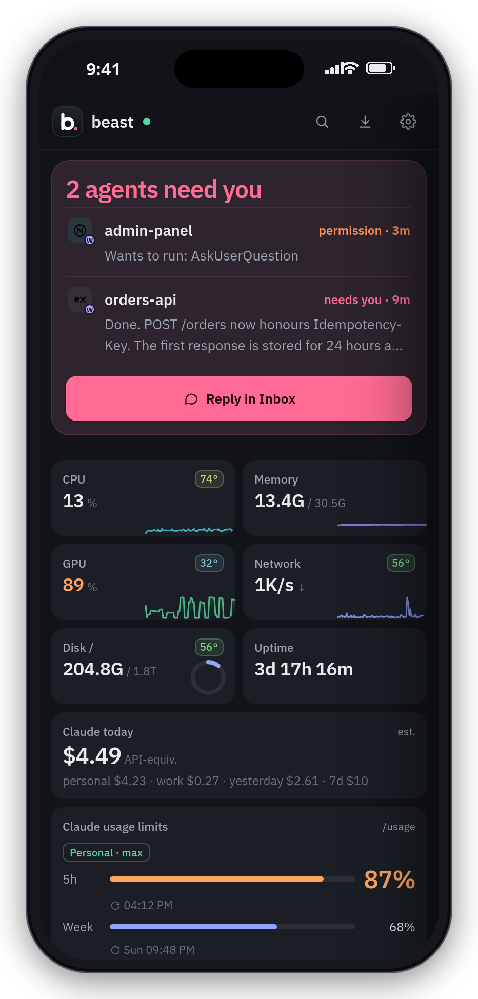

# Access — read this before exposing anything

**There is no login screen.** The dashboard runs commands and opens shells as your user; whoever
can reach the port owns the machine. Its only protection is *who can connect*:

- requests from `127.0.0.1` and from the **Tailscale** range (`100.64.0.0/10`, `fd7a:115c:a1e0::/48`)
  are accepted;
- everything else gets `403`.

So the model is: install Tailscale on the server and on your phone/laptop, and reach the dashboard
at `http://100.x.y.z:8787` from anywhere in the world, over WireGuard, with no port open to the
internet. That is what it was built for.

**No Tailscale?** Use an SSH tunnel and open `http://localhost:8787`:

```bash
ssh -L 8787:localhost:8787 -L 7681:localhost:7681 myserver
```

Another private network (a WireGuard net, a LAN)? Add its prefix to `allowedPrefixes` in
`state/settings.json`, e.g. `["10.8.0."]`. Do **not** put the dashboard on a public IP or behind
a plain reverse proxy.

The IP check alone would still let any web page open in your laptop's or phone's browser (which *is*
on the tailnet) talk to the dashboard. So it also only answers to its own names — `localhost`, IP
addresses, `*.ts.net`, short host names — and refuses requests from any other origin (another host
*or another port*, `Sec-Fetch-Site: cross-site`); the terminal (ttyd `-O`) only accepts its websocket
from its own origin. Reach it by another DNS name (e.g. `devbox.local`, `devbox.lan`)? Add that to
`allowedHosts` in `state/settings.json` and restart (`systemctl --user restart beast-dash`).

`-O` only stops browsers: the terminal port (7681) has no login of its own, so like the dashboard
port it must never be reachable from outside your tailnet / LAN (keep the firewall closed). When `install.sh`
finds no active ufw it binds the terminal to localhost only (`ttyd -i lo`); it is then reached through
`bin/enable-https.sh` (tailscale serve) or an SSH tunnel.

**Upgrading from 1.1.x:** `git pull && ./install.sh` (re-installs the units, so the terminal gets
`-O`). If the page now says *forbidden (unknown Host)*, you open it by a name that isn't an IP,
`localhost` or `*.ts.net` — add it to `allowedHosts` as above.

## On a VPS

Same steps. `./install.sh` works on any systemd distro as an unprivileged user; it needs `sudo`
twice (linger + the ufw rule) and tells you if it can't. Tailscale on the VPS + Tailscale on the
phone is the whole networking story — the VPS firewall can stay closed except for SSH.

## HTTPS, push notifications and the phone

Push notifications and "Add to Home Screen" as a real app need a secure origin. Tailscale gives
you one for free:

1. Once, in the Tailscale admin console: **DNS → HTTPS Certificates → Enable**.
2. On the server: `./bin/enable-https.sh` — sets up `tailscale serve` so that
   `https://<server>.<tailnet>.ts.net/` is the dashboard and `/term/` is the terminal, on one
   origin. Tailnet-only; nothing is published to the internet.
3. Open the HTTPS URL on the phone and laptop → ⚙ Settings → **Push → Enable on this device**.

Plain `http://<ip>:8787` keeps working; only push and the installable app need HTTPS.

On iPhone, add the page to the Home Screen (Share → Add to Home Screen): you get a full-screen
app, notifications, and the terminal with a key bar above the keyboard.

<p align="center"></p>
